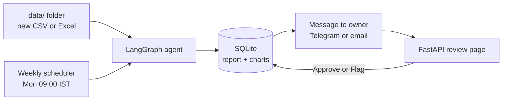
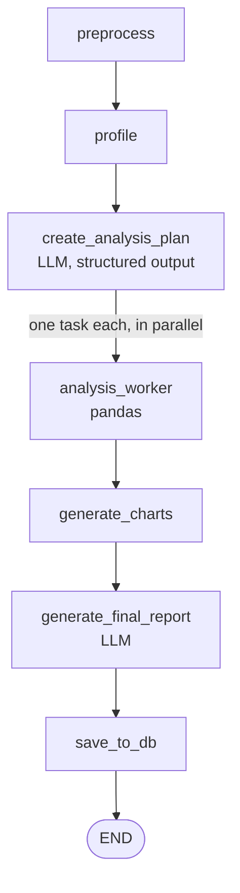

# Automation Analytic Agent

An agent that analyses a business dataset **on its own**, saves the results to a database, and **messages the owner every week** to review them. The owner opens a link, reads the report and charts, and marks the analysis as **Approved** or **Flagged**.

Built with **LangGraph**, **pandas**, **FastAPI** and **SQLite**. An LLM (Groq) plans the analysis and writes the report; all numbers are computed by pandas, never by the LLM.

<!--
Add screenshots here once you have taken them (put the images in a docs/ folder):


-->

## What it does

1. Picks up a new CSV/Excel file from the `data/` folder.
2. Cleans it (removes duplicate rows, reports missing values) and profiles it.
3. An LLM turns a question into a structured analysis plan (e.g. total sales by region, sales trend, outliers).
4. Each task runs in parallel with pandas; charts are drawn with matplotlib.
5. An LLM writes a report from the computed results only.
6. Dataset, results, report and charts are saved to SQLite.
7. The owner gets a message (Telegram and/or email) with a link to the review page.
8. The owner approves the analysis, or flags it with feedback.

The whole flow runs every Monday at 09:00 IST, or on demand from the review page.

## Architecture



The LangGraph workflow:



If preprocessing, profiling or planning fails, the graph stops early. Nothing is saved unless at least one analysis task succeeded and the report was written.

## Key design decisions

- **The LLM plans, pandas calculates.** The plan is a validated schema (Pydantic); column names in it are checked against the real columns. Every figure in the report comes from pandas results.
- **Trend direction is computed in code** (first-half average vs second-half average, with a ±5% threshold), so the report does not have to guess a direction from a shortened table.
- **Human in the loop.** An LLM-written report can still contain mistakes, so every analysis waits for the owner's review. One review per analysis; a second review replaces the first.
- **Failures are loud, not silent.** If a weekly run fails, or there is no new file, the owner is told instead of hearing nothing.

## Supported analyses

`profiling`, `statistics`, `groupby`, `correlation`, `trend`, `outlier` (IQR), `visualization` (bar / histogram) and `custom` (highest / lowest group).

## Tech stack

| Area | Tools |
|---|---|
| Agent workflow | LangGraph, LangChain, Groq (`openai/gpt-oss-120b`) |
| Data and charts | pandas, NumPy, matplotlib |
| Storage | SQLite |
| Scheduling | APScheduler |
| Review page | FastAPI, Uvicorn, Python-Markdown |

## Project structure

```text
analysis_agent.py   LangGraph workflow, analysis functions, charts, database functions
weekly_runner.py    weekly job: find new file -> run the graph -> message the owner
app.py              FastAPI review page + weekly scheduler
test.py             runs the graph once and prints every stage
data/               put the weekly CSV / Excel files here
database/           analytics.db (created automatically)
charts/             generated charts, one folder per run
requirements.txt
```

## Setup

```bash
git clone <your-repo-url>
cd automation_analytic_agent

python -m venv myenv
# Windows:      myenv\Scripts\activate
# macOS/Linux:  source myenv/bin/activate

pip install -r requirements.txt
```

Create a `.env` file in the project folder:

```text
GROQ_API_KEY=your_groq_api_key

# Review page
REVIEW_PASSWORD=choose-a-strong-password
REVIEW_BASE_URL=http://127.0.0.1:8000

# Message to the owner: set Telegram, email, or both
TELEGRAM_BOT_TOKEN=
TELEGRAM_CHAT_ID=
SMTP_HOST=smtp.gmail.com
SMTP_PORT=465
SMTP_USER=
SMTP_PASSWORD=
OWNER_EMAIL=
```

If neither Telegram nor email is configured, the message is printed in the terminal instead.

## Usage

**1. Try the agent once**

```bash
python test.py
```

This creates a small `sample_sales.csv` (date, region, sales), runs the graph, and prints the plan, task results, charts and the final report. The result is also saved to the database.

**2. Start the review page and the weekly scheduler**

```bash
python -m uvicorn app:app --host 127.0.0.1 --port 8000
```

Open `http://127.0.0.1:8000`. Log in with any username and your `REVIEW_PASSWORD`.

- Put a CSV/Excel file in `data/`.
- Click **Run weekly job now**, or wait for Monday 09:00 IST.
- Open the analysis, read the report and charts, then click **Approve** or **Flag** (feedback is required when flagging).

Run **one worker only**. Each worker would start its own scheduler, and the owner would get duplicate messages.

**3. Run the weekly job once, without the web page**

```bash
python weekly.py --now
```

## Database

| Table | Holds |
|---|---|
| `datasets` | file name, path, row and column counts |
| `analysis_runs` | question, task results (JSON), report, chart files |
| `reviews` | `approved` or `flagged`, feedback, time |

## Limitations

- **Data comes from a folder.** The agent analyses files placed in `data/`; it does not yet pull from Google Sheets, a database or an API.
- **Runs locally by default.** For the owner to open the link on a phone, the app has to be hosted (or tunnelled) and `REVIEW_BASE_URL` set to that address.
- **Simple access control.** One shared password (HTTP Basic), no user accounts.
- **Trend direction is a simple comparison,** not a statistical test, and noisy data can show a direction that is not significant.
- **Flag feedback is stored but not yet used** to improve the next run.
- Developed and tested on a synthetic sales dataset.

## Roadmap

- Upload a file from the review page.
- Connectors for Google Sheets and databases.
- Feed flagged feedback back into the next analysis.
- Docker image and deployment guide.
- Automated tests.
